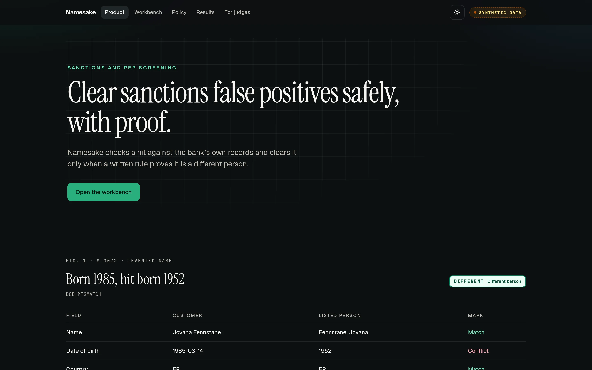
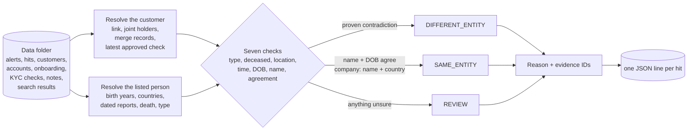
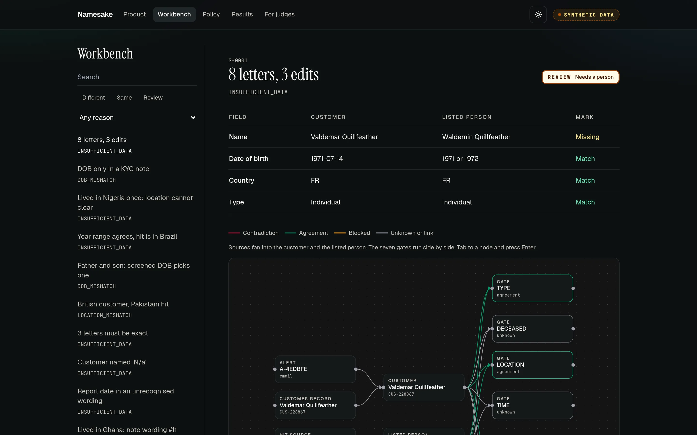
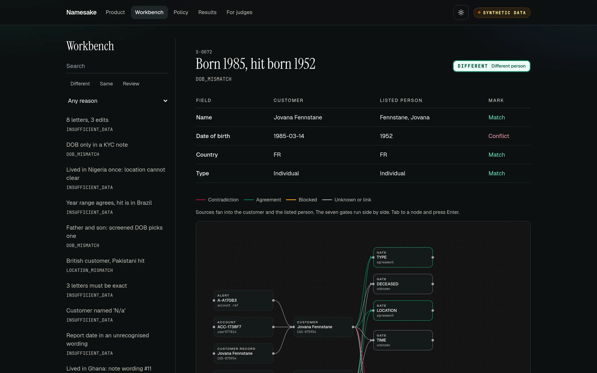
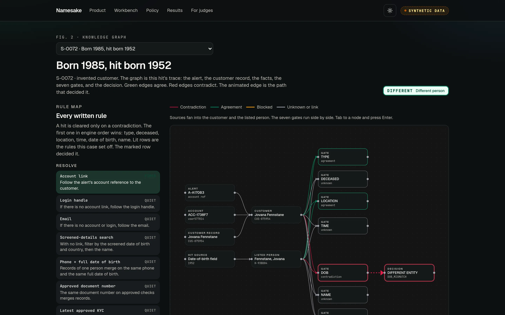
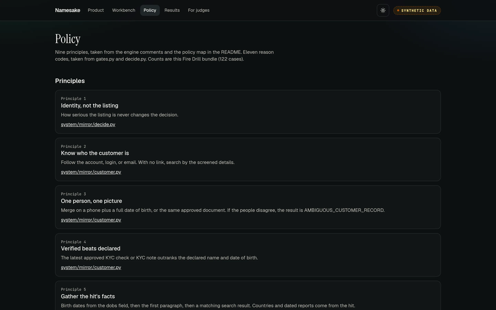
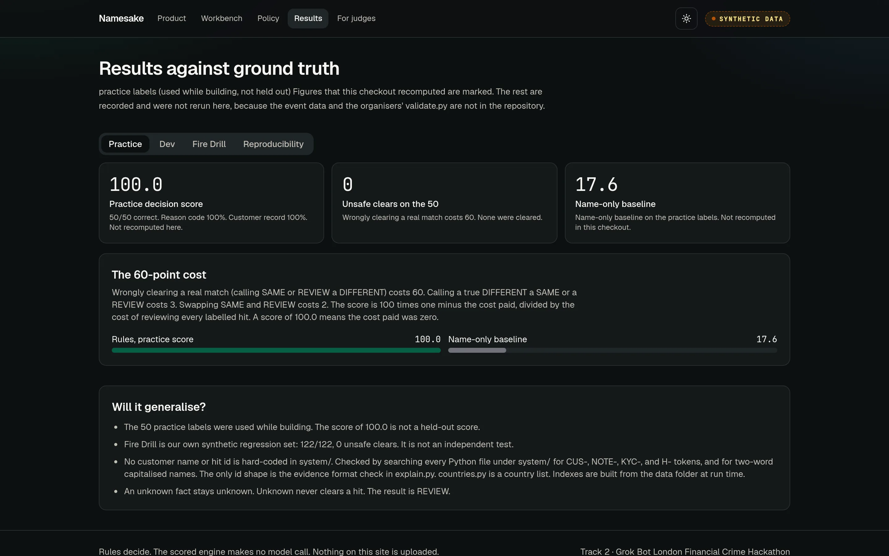
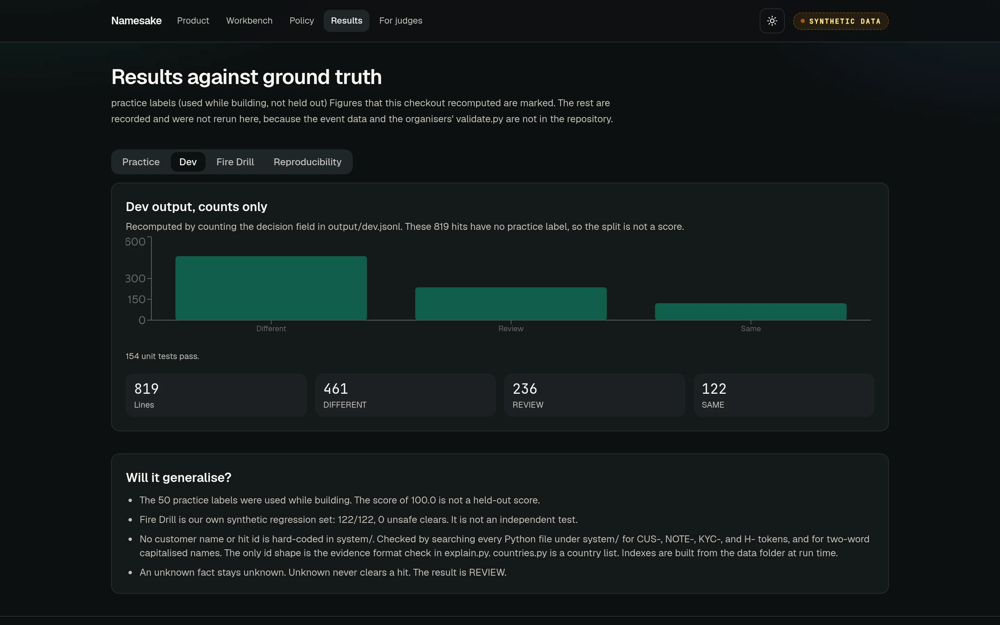
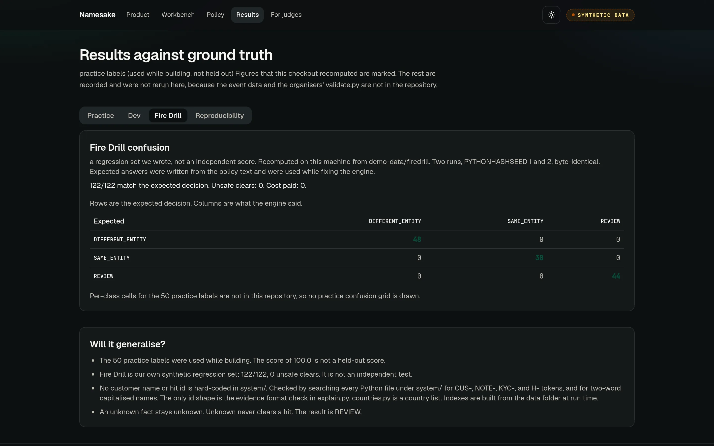

# Namesake

> **Clears false sanctions hits only when it can prove a contradiction, and shows its evidence.**

<p align="center">
  
</p>

<p align="center"><b>An open, rules-based engine for watchlist screening.</b><br/>
For each screening hit it decides <b>same person</b>, <b>different person</b> or <b>needs a human</b>.<br/>
It writes a short reason and lists the record IDs it relied on. Python standard library only, no model and no network. Every run gives byte-identical output.</p>

<p align="center">
  
  
  <a href="https://namesake-pearl.vercel.app"></a>
</p>

<p align="center">
  <a href="https://namesake-pearl.vercel.app">Live demo</a> ·
  Demo video (coming soon) ·
  <a href="#the-problem">The problem</a> ·
  <a href="#what-namesake-does">How it works</a> ·
  <a href="#results-measured-honest">Results</a> ·
  <a href="#for-judges">For judges</a> ·
  <a href="#quickstart">Quickstart</a>
</p>

> Built solo at the Grok Bot London Financial Crime Hackathon (21 Nov 2026), Track 2 "Same Person or Not?".
>
> **Live demo:** https://namesake-pearl.vercel.app
> **Demo video:** coming soon.

---

## The problem

A bank screens every customer's name against sanctions, PEP, enforcement and adverse-media lists. The matching is loose on purpose, so most hits are a **different person who shares a name**. An analyst has to clear each one by hand, and that's slow.

Two things make it hard (from the track brief):

- **The customer side is messy.** The alert shows the customer as screened, sometimes with a nickname or a typo. Their real details are spread over a system of record, accounts, onboarding, a KYC provider and a support tool. None of these share one key.
- **The watchlist side is messy too.** A hit's date of birth may sit in a field, in a sentence like "aged 45 when sentenced in March 2019", or only in web search results. Most of those results are about namesakes.

The expensive mistake is clearing a real match, because then a sanctioned person stays a customer. The scoring reflects that: an unsafe clearance costs **60**, and the other mistakes cost **2 or 3**.

## What Namesake does

1. **Finds the real customer.** It follows the alert's link (account, login or email), picks between joint holders using the screened details, or searches the system of record when there's no link. Records of one person are merged on the same phone number plus the same full date of birth, or on the same approved document number.
2. **Uses verified facts first.** The most recent *approved* identity check gives the legal name, date of birth and document country. Rejected, expired or pending checks are ignored.
3. **Reads the listed person.** It takes their birth years (from the field, an age in the profile or a matching search result), their countries, dated reports, any date of death, and whether it's a person or a company.
4. **Runs seven checks in a fixed order:** type, deceased, location, time, date of birth, name and agreement.
5. **Decides safely.**
   - It clears only on a concrete contradiction.
   - It confirms only when the name and date of birth agree (name and country for a company).
   - Everything else goes to **REVIEW**.
   - Anything unknown stays unknown and never clears a hit.
6. **Explains the decision.** The reason is 2–4 sentences built from this hit's own facts, and `evidence` lists only the records that decided it.



## The site

The public site is a product page and an analyst workbench over **synthetic Fire Drill cases** (invented names only). It does not ship event data.

<p align="center">
  
  
</p>
<p align="center"><em>Left: the workbench queue. Right: case S-0072, cleared as a different person because the dates of birth contradict.</em></p>

<p align="center">
  
</p>
<p align="center"><em>The knowledge graph for the same case. Sources fan into the two people; the seven gates run by the side; the marked path is the rule that decided it.</em></p>

<p align="center">
  
  
</p>
<p align="center"><em>Left: every written policy principle, mapped to the code. Right: practice labels, 50/50, no unsafe clearances (not a held-out score).</em></p>

<p align="center">
  
  
</p>
<p align="center"><em>Left: all 819 dev hits, counts only (no labels). Right: Fire Drill, 122/122, used as a regression test while fixing the engine.</em></p>

## Results (measured, honest)

| What | Result | Caveat |
|---|---|---|
| Organisers' `validate.py` on dev output | 819 lines, 0 problems | format check |
| Practice labels (50 hits) | 50/50 right, **0 unsafe clearances**, decision score 100.0, reason code 100%, customer record 100% | the labels were used while building, so this is **not** a held-out score |
| All 819 dev hits | 461 `DIFFERENT_ENTITY`, 236 `REVIEW`, 122 `SAME_ENTITY` | counts only; dev has no labels |
| Fire Drill (our synthetic trap set, 122 hits) | 122/122, 0 unsafe clearances | we used it to fix bugs, so it's a regression test |
| Determinism | byte-identical across runs and hash seeds; `output/dev.jsonl` sha256 `f454c71d…` | |
| Unit tests | 154 run, all pass | |
| Run time | about 6 seconds on dev, on a laptop | no API cost |

We haven't measured the score on the organisers' unseen set, and nobody can until they run it.

## Quickstart

Python 3, standard library only. There's nothing to install and no key needed.

```bash
# synthetic demo data (safe to share, invented names)
system/run demo-data/firedrill out.jsonl

# the event data room (kept locally, never committed)
system/run path/to/screening/dev output/dev.jsonl
```

On Windows, or anywhere without `sh`:

```powershell
python system\mirror\main.py demo-data\firedrill out.jsonl
```

## For judges

The scored entry point is `system/run <data folder> <output file>`. On Windows, or anywhere without `sh`, use `python system\mirror\main.py <data folder> <output file>`.

Architecture, evidence, determinism, three worked cases and limits are in [`system/README.md`](system/README.md).

The live site is at https://namesake-pearl.vercel.app (synthetic data only). A demo video is coming soon.

## Verify it yourself

```bash
python -m unittest discover -s tests                          # unit tests (synthetic values only)
python tools/repro.py --data DATA --runs 5                    # 5 fresh runs, byte comparison
python tools/score.py --data DATA --output output/dev.jsonl --validate path/to/validate.py   # practice score
python tools/final_check.py --data DATA --validate path/to/validate.py   # everything before a submit
python tools/leakcheck.py --data DATA                         # no event names or IDs in tracked files
python tools/firedrill.py --out demo-data/firedrill --seed 7  # regenerate the synthetic set (byte-identical)
```

## Policy to code

The rules come from the bank's identity SOP (`POLICY.md`, supplied with the event data and not copied here). Namesake implements it like this:

| POLICY principle | Where in the code | Outcome / reason code |
|---|---|---|
| 1. Identity, not policy | whole engine: how serious the listing is never matters | — |
| 2. Know who the customer is | `customer.py`: link, joint holders, search with no link | `customer_record_id` |
| 3. One person, one picture | `customer.py`: merge on phone + full DOB, or approved document number | `REVIEW` / `AMBIGUOUS_CUSTOMER_RECORD` when people disagree |
| 4. Verified beats declared | `customer.py`: latest approved KYC check or KYC note | feeds the name, DOB and time checks |
| 5. Gather the hit's facts | `hit.py`: `dobs`, first paragraph, matching search results, countries, dated reports | feeds every check |
| 6. Clear only on a contradiction | `gates.py`: TYPE, DECEASED, LOCATION, TIME, DOB, NAME | `ENTITY_TYPE_MISMATCH`, `DECEASED`, `LOCATION_MISMATCH`, `TEMPORAL_IMPOSSIBILITY`, `DOB_MISMATCH`, `NAME_MISMATCH_VERIFIED` |
| 7. Confirm only on agreement | `gates.py`: AGREEMENT | `NAME_DOB_LOCATION_MATCH`, `NAME_DOB_MATCH`, `NAME_LOCATION_MATCH` (companies); else `INSUFFICIENT_DATA` |
| 8. Names | `names.py`: parts, variants, joined forms, edit limits, initials, placeholders, legal forms | used by the name and agreement checks |
| 9. Cite what you used | `explain.py`: only the deciding records | `evidence`, `reason` |

## What the organisers gave vs what we built

**Given:** the brief, the data room, `POLICY.md` (decisions, principles, reason codes) and `validate.py`.

**Built here:**
- customer resolution across five systems with no shared key, including joint holders and record merging
- extraction of the listed person's facts from free text and from search results, keeping only results that really describe them
- name matching to the policy's rules
- a safety-first decision order where unknown never clears
- template reasons with exact citations
- deterministic output
- tools to prove all of this: repro, practice scoring, leak check, final check, the synthetic Fire Drill generator and a decision comparer
- a public site that shows the rule path on synthetic cases

## Repo map

| Path | What |
|---|---|
| `system/run` | entry point the organisers call: `system/run <data folder> <output file>` |
| `system/mirror/` | the engine: `load`, `customer`, `hit`, `gates`, `decide`, `explain`, `main` |
| `system/README.md` | the judges' README: architecture, evidence, determinism, three worked cases, limits |
| `output/dev.jsonl` | our predictions on the development set (required deliverable) |
| `tools/` | repro, score, final check, leak check, Fire Drill generator, decision comparer, site bundler |
| `tests/` | unit tests, synthetic values only |
| `demo-data/firedrill/` | synthetic data with expected answers (invented names) |
| `web/` | product site (Vite + React, HashRouter). In `web/`, run `npm ci` then `npm run build`. |
| `docs/` | architecture notes and data contracts |
| `docs/images/` | screenshots of the live site, used in this README |
| `data/` | git-ignored; put the event data here locally |

## Honest limits

- The unseen-set score is unknown.
- The location check does a lot of the clearing, and it depends on finding every country the notes mention for the customer. A note worded in a way we don't recognise is the main risk of a wrong clear. To reduce it, a place we can't read blocks location clears.
- We don't clear companies on name (for example "Munchen" vs "Munich"). Companies clear only on type, location or time.
- Two dev `SAME_ENTITY` decisions rest on an age taken from a search-result snippet. They're the least certain.
- No model is used. That's a deliberate choice for reproducibility and safety. The brief allows an LLM through OpenRouter, but the scored engine doesn't call one.

## Data and safety

- Event data is for participants only and is never committed. `data/`, `.env*` and any stray `*.jsonl` are git-ignored.
- `output/dev.jsonl` is the only event-derived file, and the brief requires it. Its reasons hold derived facts (years, countries, record IDs), not names or quoted text.
- The public site and the screenshots in `docs/images/` show synthetic Fire Drill cases only.
- `tools/leakcheck.py` checks this before every push.

## Team

Iyad Zuberi ([@IyadZuberi](https://github.com/IyadZuberi)).

## Licence

MIT, see [LICENSE](LICENSE).
